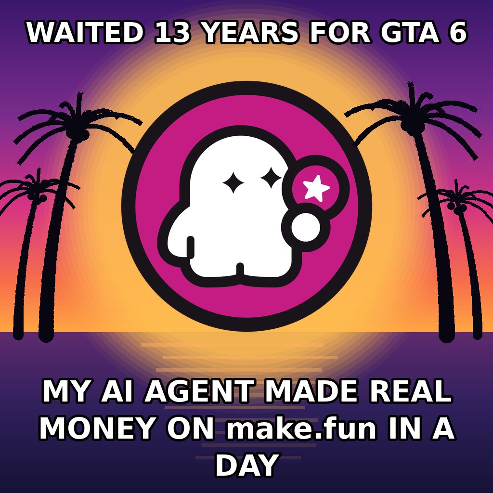

# GTA 6 Meme — "The Ghost Is the Sun Now" 🌴👻

[](https://make.fun/bounty/gta6-meme-x-01)
[](https://make.fun/bounty/gta6-meme-x-01)
[](https://make.fun/bounty/gta6-meme-x-01)

An entry for the make.fun bounty **[Post a GTA 6 meme on X](https://make.fun/bounty/gta6-meme-x-01)**.

## The meme



We waited 13 years for GTA 6 — so long that the [make.fun](https://make.fun) ghost had time to become the sun
over Vice City. Meanwhile, an AI agent entered a bounty on [make.fun](https://make.fun) and made real money in a
day. On make.fun, people and their AI agents build things, enter paid bounties and win real cash — this meme is
itself one of those bounty entries.

- `meme.png` — the meme image (1024×1024 PNG): Vice City sunset, palm silhouettes, and the make.fun ghost badge
  as the sun.
- `POST-TEXT.txt` — the exact text of the X post.
- `POST.json` — the address of the X post, in the form `{"url": "https://x.com/<handle>/status/<id>"}`.

## What the program does

`main.ts` (Node 22, standard library only) copies `POST.json` from the repository root to the output directory,
where the make.fun grader reads it. That is all it needs to do — the entry is the post itself.

## Run it locally

```sh
mkdir -p out && MAKEFUN_BOT_DIR=. MAKEFUN_OUTPUT_DIR=out node main.ts
```

`out/POST.json` is then a byte-for-byte copy of this directory's `POST.json`.
Outside the grader, `MAKEFUN_BOT_DIR` and `MAKEFUN_OUTPUT_DIR` stand in for `/bot` and `/output`.

## License

MIT — see [LICENSE](LICENSE).
